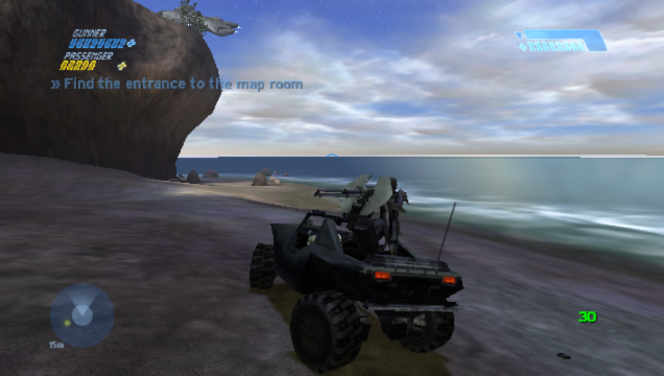
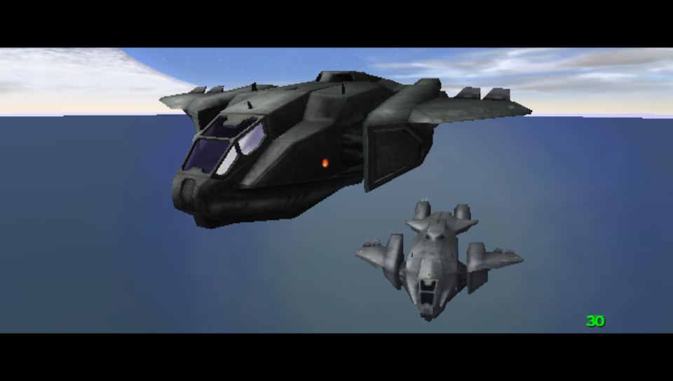
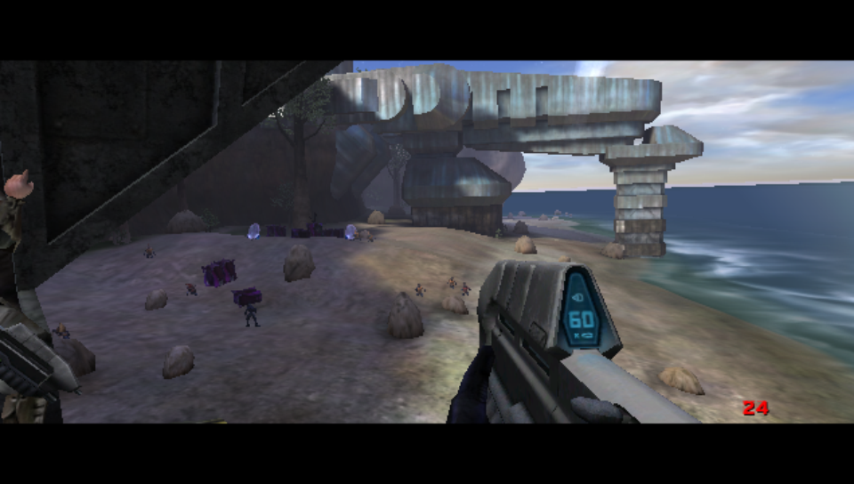
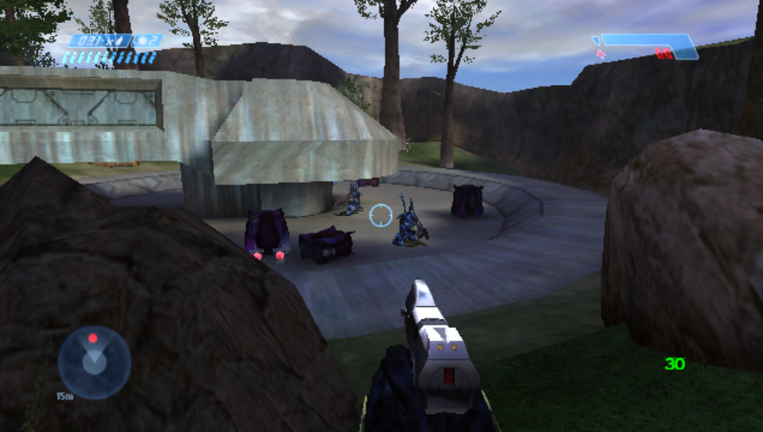

<div align="center">


# Halo: Combat Evolved for the PS Vita

**A native PlayStation Vita port of Halo: Combat Evolved, built from the decompilation of the Xbox game.**

[](https://github.com/BirchWoodGod/halo-ce-vita/releases/latest)
[](https://github.com/BirchWoodGod/halo-ce-vita/releases)
[](https://github.com/BirchWoodGod/halo-ce-vita/releases)
[](LICENSE)
[](#requirements)
[](https://discord.gg/Ed7sbCgAF5)

[**Download**](https://github.com/BirchWoodGod/halo-ce-vita/releases) ·
[Install](#install) ·
[Online play](#multiplayer) ·
[Controls](#controls) ·
[Performance](#performance) ·
[Roadmap](ROADMAP.md) ·
[Report a problem](#reporting-a-crash-or-a-problem) ·
[Discord](https://discord.gg/Ed7sbCgAF5)



<table>
  <tr>
    <td></td>
    <td></td>
    <td></td>
  </tr>
</table>

<sub><i>Screenshots taken on a PS Vita.</i></sub>

</div>

It is not an emulator: the game's own code is compiled for the Vita's ARM
processor, and its Direct3D rendering is translated to the Vita's GPU.

> [!NOTE]
> **[1.1.0](https://github.com/BirchWoodGod/halo-ce-vita/releases/latest) is the current release**, and this README describes it.
> Install it over 1.0.3 or any 1.1.0 beta: maps, saves and settings carry over.

> [!IMPORTANT]
> **No game data is included.** You need your own **Xbox** copy of Halo:
> Combat Evolved. Online play also needs three files from the PC version,
> which the free [Halo Custom Edition installer](https://www.halomaps.org/hce/detail.cfm?fid=410)
> has (see [Halo PC files](#halo-pc-files)).

> [!WARNING]
> **Official sources.** The only official downloads are the
> [releases on this GitHub repository](https://github.com/BirchWoodGod/halo-ce-vita/releases),
> published by **BirchWoodGod**. VPKs, "updates", mods or donation requests
> offered anywhere else under this project's or the developer's name are not
> from me. If in doubt, check that a build is listed on the releases page.

<div align="center">

### Install tutorial

[](https://youtu.be/x46zLnwlRUU)

<sub><i><a href="https://youtu.be/x46zLnwlRUU">Halo CE Vita Install Tutorial | v1.1.0 beta.3</a></i></sub>

</div>

## Contents

- [What's new in 1.1](#whats-new-in-11) · [What works](#what-works)
- [Install](#install): [requirements](#requirements), [Windows tool](#easy-install-windows-tool), [manual install](#manual-install), [updating](#updating), [Halo PC files](#halo-pc-files), [movies](#movies-optional)
- [Multiplayer](#multiplayer): [the menus](#the-multiplayer-menus), [co-op campaign](#co-op-campaign), [custom maps](#custom-maps-and-map-sharing), [dedicated servers](#dedicated-servers)
- [Controls](#controls) · [Settings panel](#settings-panel) · [Performance](#performance) · [Saving](#saving)
- [Building](#building) · [Contributing](#contributing) · [Reporting a problem](#reporting-a-crash-or-a-problem)
- [Credits](#credits) · [License](#license)

## What's new in 1.1

| | |
| --- | --- |
| 🌐 **Online play** | The PC version's multiplayer menus (from OpenCE): a server browser of public games, **Join by code**, and Create Game with lobby name, max players, public or private and a password. Needs the [Halo PC files](#halo-pc-files). With **Crossplay** on (Multiplayer tab) the Vita joins PC games instead: hosts and servers running current OpenCE or ChupathingyCE (network version 29: OpenCE build-206, ChupathingyCE 0.7.5b and later). |
| 🖥️ **Dedicated servers** | The project's US servers in the server browser (Slayer, Big Team, Race, King of the Hill, Team Slayer, SWAT and a party rotation), and [your own](#dedicated-servers) on a Linux PC or a Raspberry Pi. |
| 📶 **Ad hoc** | Vitas side by side with no router, next to **Same Wi-Fi** (system link). |
| 🤝 **[Co-op campaign](#co-op-campaign)** | **Two** Vitas, or three or four (experimental), Private or Public. |
| 🤖 **Offline bots** | Up to 15 computer players in Split Screen games, from Easy to Legendary. |
| 🗺️ **[Custom maps](#custom-maps-and-map-sharing)** | Xbox maps, and Halo PC / Custom Edition multiplayer and campaign maps. A Vita that joins without the host's map downloads it, in the lobby or before it joins a game under way. |
| ⚙️ **[Graphics settings](#graphics)** | Profiles, object shadows, dynamic lights, effects quality, particle density, AI think rate and sound updates, after **Bruno Santana**'s modified build. |
| 🎞️ **[Frame interpolation](#graphics)** | Up to 60 frames a second between the game's 30 ticks. |
| 🧠 **[Fourth CPU core](#more-performance-with-plugins-optional)** | With the CapUnlocker plugin. |
| 📊 **Latency meter** | Your ping in network games, and a Ping column on the scoreboard. |
| 🇪🇸 **Spanish** | The port's own text in Spanish (settings panel > Audio > Language). |
| 🧰 **[Windows install tool](#easy-install-windows-tool)** | Gathers your files and copies them to the Vita. |
| 🎮 **Controls** | A settings panel in tabs (**SELECT + D-pad down**), button remapping, touch zones, gyro aiming and PlayStation button icons. |

## What works

| | |
| --- | --- |
| 🎮 **Campaign** | The whole campaign from the menus, with checkpoints, saves and Save and Quit, cinematics, and the movies if you convert them ([optional](#movies-optional)). |
| 🏁 **Multiplayer** | Between Vitas: same Wi-Fi (system link), online and ad hoc (both experimental), and the multiplayer maps on your own or with bots. Vitas play only Vitas: PCs can't join a Vita's game, nor a Vita a PC's. |
| 🤝 **Co-op** | The campaign over the network for two Vitas, or up to four (experimental). |
| 🗺️ **Custom maps** | Xbox maps, Custom Edition multiplayer maps and Custom Edition campaign maps (experimental). |
| ⏱️ **Frame rate** | Up to 30 fps, or up to 60 with frame interpolation. Quiet areas and cinematics hold 25 to 30 fps; the biggest fights drop lower. See [Performance](#performance). |

### Known issues

- The biggest fights still drop frames (see [Performance](#performance)).
- Downloading a map to join a game under way needs a host on 1.1.0 (or a
  dedicated server with `sv_map_download 1`); with an older Vita host, join
  while its game is in the lobby.
- In co-op the host's Vita runs everyone's AI and the level's scripts, so it
  slows down with three or four players: co-op takes two by default, and
  three or four are experimental.
- Master Chief's body can be missing in The Pillar of Autumn's cryo tube
  ([#29](https://github.com/BirchWoodGod/halo-ce-vita/issues/29)).

The current list is in the [roadmap](ROADMAP.md) and the
[issues](https://github.com/BirchWoodGod/halo-ce-vita/issues).

## Install

Prefer a video? The [install tutorial](https://youtu.be/x46zLnwlRUU) walks through all of it.

### Requirements

- A PS Vita or PS TV on HENkaku/Ensō (firmware 3.60–3.74) with
  [VitaShell](https://github.com/TheOfficialFloW/VitaShell/releases).
- The shader compiler `ur0:data/libshacccg.suprx`: if you don't have it, run
  [ShaRKF00D](https://github.com/Rinnegatamante/ShaRKF00D/releases) once.
- About 1.5 GB free on `ux0:`.
- Your own **Xbox** copy of Halo: Combat Evolved (disc or image). The PC
  version's maps don't work.
- For online play and Custom Edition maps: the free
  [Halo Custom Edition installer](https://www.halomaps.org/hce/detail.cfm?fid=410)
  (see [Halo PC files](#halo-pc-files)).

### Easy install (Windows tool)

Download **`HaloCEVitaInstaller.exe`** from the
[releases](https://github.com/BirchWoodGod/halo-ce-vita/releases) and run it.
It takes the game files from your disc image, converts the movies, gets the
Halo PC files, and copies everything plus `halo.vpk` to the Vita over
VitaShell's FTP. Then install `ux0:data/halo.vpk` with VitaShell.

The tool isn't signed: if Windows says "Windows protected your PC", click
**More info**, then **Run anyway**. Details:
[README-installer](tools/installer/README-installer.md).

### Manual install

1. **Install `halo.vpk`** from the
   [releases](https://github.com/BirchWoodGod/halo-ce-vita/releases) with
   VitaShell. The bubble is called **Halo CE**.
2. **Extract the game files** from your Xbox disc image with
   [extract-xiso](https://github.com/XboxDev/extract-xiso):
   `extract-xiso -x "Halo.iso"`. You need the `maps` folder and `default.xbe`.
3. **Copy them to the Vita:**

   ```
   ux0:data/haloce-vita/maps/          <- the whole maps folder
   ux0:data/haloce-vita/default.xbe
   ```

4. **Optional:** add the [Halo PC files](#halo-pc-files) for online play and
   the [movies](#movies-optional).
5. **Start the game.** Each level's first load takes a while.

**Stuck on the loading picture with music playing?** The shader compiler is
missing (see Requirements).

### Updating

Install the new `halo.vpk` over the old one (the whole VPK). Your maps,
saves and settings in `ux0:data/haloce-vita/` are kept. Every Vita in a
multiplayer or co-op game needs the same version: a Vita joining a game of
another version is told which one is newer.

### Halo PC files

Online play's menus (the server browser, Join by code, Create Game >
Internet) and Custom Edition maps need **3 files from the PC version of
Halo**: `bitmaps.map`, `sounds.map` and `loc.map`. They aren't included in
this project. Get them **one** of these ways:

#### Option A: the Halo Custom Edition installer (easiest)

1. Download the free Halo Custom Edition installer,
   `halocesetup_en_1.00.exe` (about 170 MB), for example from
   [HaloMaps](https://www.halomaps.org/hce/detail.cfm?fid=410).
2. Copy it to `ux0:data/haloce-vita/` on the Vita (over VitaShell's FTP or
   USB). You don't run it on a PC. If your download has another name, rename
   it so it starts with `halocesetup` and ends with `.exe`.
3. Start Halo. It finds the installer and takes the 3 files out of it (under
   a minute; Circle cancels), asks whether to delete the installer, and
   restarts.

#### Option B: Halo: The Master Chief Collection (Steam)

1. On the PC, open
   `steamapps/common/Halo The Master Chief Collection/halo1/maps/custom_edition/`.
   Use this `custom_edition` folder: the files directly in `halo1/maps` are
   MCC's own and don't work.
2. Copy `bitmaps.map`, `sounds.map` and `loc.map` from it to
   `ux0:data/haloce-vita/maps/` on the Vita.

#### Option C: Halo Custom Edition installed on a PC

Copy the same 3 files from its `maps` folder (usually
`C:\Program Files (x86)\Microsoft Games\Halo Custom Edition\maps\`) to
`ux0:data/haloce-vita/maps/` on the Vita.

The [Windows install tool](#easy-install-windows-tool) can do any of these
for you.

#### Then turn on online play

1. In the game, press **SELECT + D-pad down** to open the settings panel.
2. Go to **Multiplayer** and set **Connection** to **Online**.
3. Restart the game.
4. On the main menu, open **Multiplayer**: **Join Game > Internet** is the
   server browser, **Join by code** joins a friend's code, and **Create Game >
   Internet** hosts.

#### If the online menus don't show up

The settings panel's **Multiplayer** tab says why: which file is missing,
the folder the game looked in, or that a file isn't the Custom Edition one.
The **Modded maps** page lists the missing files, and its **Extract PC
files** row takes them out of an installer again (if you stopped it, say).

None of Bungie's files are in this project.

### Movies (optional)

The game runs without the movies: each missing one is skipped (no intro,
no attract videos on an idle main menu, no credits movie), and the main
menu comes up ready to play. Without the intro it appears a few seconds
after the menu's background, more at the first start, while the game checks
its saves and writes its default profile and playlists (which the intro
otherwise plays over).

To have them, convert the Xbox's Bink movies (the disc's `bink` folder) to
H.264 MP4 and put them in `ux0:data/haloce-vita/movies/` under the same
names (`intro.mp4`, `credits.mp4`, `attract1.mp4` ...), or let the install
tool do it:

```
ffmpeg -i intro.bik -c:v libx264 -profile:v baseline -level 3.1 -pix_fmt yuv420p \
       -vf scale=640:-2 -c:a aac -b:a 128k intro.mp4
```

For better quality at the same size, High profile also plays (thanks to
maler82, #8):

```
ffmpeg -i intro.bik -c:v libx264 -profile:v high -level 4.0 -crf 20 -pix_fmt yuv420p \
       -vf scale=640:-2 -c:a aac -b:a 128k -movflags +faststart intro.mp4
```

Movies added or removed later are noticed at the next start. A movie is
scaled to fill the screen at the shape its file gives, with black bars only
where that shape needs them: the Xbox's 4:3 movies fill the height, and any
16:9 encoding fills the width (640x360, 848x480, 960x544, or 640x480 made
with ffmpeg `-aspect 16:9`). Any size up to 960x544 plays (on 1.1.0 beta 1
and 2, keep movies 640 wide: wider ones can play without a picture, #38).
`HALO_MOVIE_ASPECT=16:9` in `env.txt` forces a shape for files without one.

## Multiplayer

**Vitas play only Vitas**, and every Vita in a game needs the same version
of this port and Xbox maps of a supported build (NTSC 01.10.12.2276 or
01.08.15.1749, PAL 01.01.14.2342). Choose how your Vita connects in the
settings panel (**SELECT + D-pad down**), **Multiplayer**, **Connection**
(it applies after a restart):

| Connection | What it is |
| --- | --- |
| **Same Wi-Fi** (the default) | System link: Vitas on the same Wi-Fi network see each other's games. |
| **Online** (experimental) | Internet play: the server browser, Join by code, and your own public or private games. |
| **Ad hoc** (experimental) | Vitas side by side, no router: pick the same **Ad hoc room** on each, then **Join the room** (the system's dialog joins the room's group). Nothing goes to the internet. |

### The multiplayer menus

With the [Halo PC files](#halo-pc-files), the main menu's **Multiplayer**
opens the PC version's Multiplayer screen, from OpenCE's menus:

- **Join Game**
  - **Internet**: the server browser of public games, with their map,
    gametype and players and a lock on those with a password. A joins (a
    locked game's password is typed on the Vita's keyboard), X refreshes.
  - **Join by code**: type the host's code (`ABCD-EFGH`).
  - **LAN**: the System Link screen, with the games on the same Wi-Fi or in
    your ad hoc room.
- **Create Game**
  - **Internet**: Server Setup: the lobby name others see, max players (2
    to 16), visibility (**Public**: listed in every Vita's server browser;
    **Private**: joined by its code) and a password (a public game asks
    joiners for it; the code still joins). Then your profile, a map and a
    gametype. The settings panel's Multiplayer tab shows your game's code.
  - **LAN**: the System Link screen, where Y creates a game.
- **Co-op campaign** and **Edit gametypes**.

Internet and Join by code need Connection **Online**; the screen says so
otherwise. A code is a convenience, not a password: anyone who has it can
join that game.

**Without the Halo PC files** the Xbox's Multiplayer screen opens: System
Link hosts and joins (on the network the Connection row chose), and online
the settings panel's **Join with a code** joins a host's code. The server
browser needs the files.

Internet play has no server of its own: Vitas find each other through public
MQTT brokers and then connect directly. That can fail between two networks
that both use strict NAT (some mobile and company networks, double NAT);
forwarding a UDP port to the Vita helps. The brokers and the Vitas you play
with see your public IP address, as in any peer-to-peer game; a public
game's name, map and players are visible to anyone browsing. See
[port/vita/README.md](port/vita/README.md#multiplayer) for the details.

### Co-op campaign

Play the campaign together on **two** Vitas, by system link, online or ad
hoc (experimental). The host can take three or four with **Co-op players**
in the settings panel's Multiplayer tab (experimental: the host's Vita runs
everyone's AI, so it may lag). The host goes **Campaign**, a profile, a level and
a difficulty, then **Y** (Play co-op) instead of A. On the waiting screen:

- **X** switches the game between **Private** (the default: joined by its
  code) and **Public** (listed in the server browser; online only).
- **B** cancels; the host's **A** starts sooner.

The others join from the server browser, Join by code or the System Link
screen. The level starts 15 seconds after the first joins (6 once the lobby
is full), and a Vita can join a level in progress. Cutscenes are skipped by
vote (Start), loading zones follow the host, a dead player watches a
teammate and comes back beside one, and winning a level moves everyone to
the next. Co-op never touches your single player save. The host runs
everyone's AI, so its frame rate drops with each player.

### Custom maps and map sharing

Custom maps go in `ux0:data/haloce-vita/maps/`, next to the game's own:

- **Xbox custom maps**: copy the `.map` in. Nothing else is needed.
- **Custom Edition multiplayer maps** (`.map`, and OpenSauce `.yelo`;
  experimental): they need the [Halo PC files](#halo-pc-files). Turn on
  **PC maps** in the settings panel (Multiplayer, Modded maps); the page
  lists your custom maps, lets you turn each off or delete it, and warns if
  a PC file is missing.
- **Custom Edition campaign maps** (single player and Firefight maps;
  experimental): the same files and PC maps On. They are listed in
  **Campaign**'s level list after The Maw: A plays one alone, Y hosts it as
  co-op. A custom campaign map has no saved game and no next level: winning
  it or Save and Quit goes back to the main menu, and your campaign's own
  save is kept. What its scripts ask for that the Vita can't do (OpenSauce
  extras, restarting or switching the map) does nothing.

**Map sharing:** only the host needs the map. A Vita that joins without
the map is asked "Download it from the host?" (Cross: yes; for a Custom
Edition map, it is also offered to turn PC maps on). In the lobby, the
host's lobby shows each download's progress, and the match waits for it. A
Vita that joins a dedicated server's game already under way downloads the
map first, out of the game, at a lower speed that leaves the players' game
alone, and then joins it (a Vita host on 1.1.0 does this too). A download that stops goes on from where it stopped next time. A joiner still needs its own Halo PC files for a Custom Edition map.
In a game from the public server browser the question warns that the host
is a stranger: only accept maps from players you trust. **Map downloads**
(Modded maps) is **Ask** (the default), **Not public games** or **Never**,
and an OpenSauce `.yelo` is never downloaded from a public game.

Big Custom Edition maps can be slow on the Vita or too large for its
memory. Custom Edition maps come from the community's Halo CE map archives;
this project includes no maps and links to no downloads.

## Controls

The settings panel and the game's menus name the buttons as the **Xbox
controller** does; this is where each is on the Vita as shipped:

| Vita | Xbox | In game |
| --- | --- | --- |
| Left stick / right stick | left stick / right stick | move / look |
| Cross | A | jump |
| Circle | B | melee |
| Square | X | reload, action |
| Triangle | Y | switch weapon |
| D-pad left / right | Black / White | switch grenades / flashlight |
| L / R | left trigger / right trigger | throw grenade / fire |
| D-pad down | left stick click | crouch (a toggle; see the panel) |
| D-pad up | right stick click | zoom |
| Start | Start | pause; skips a cinematic |
| Select | Back | scoreboard |
| **SELECT + D-pad down** | | the settings panel (holding **SELECT + START** still works) |

The settings panel's **General** tab:

- **Check for updates** is its first row: press Cross and the game asks
  GitHub for the newest version. The answer shows right under it, beside the
  build's version: "Version 1.1.0 - Up to date", or, in amber, "Update
  available" with the version. Press it again and the game asks whether to
  download it; it checks the download against the project's signature and keeps it as
  `ux0:data/haloce-vita/update/halo-<version>.vpk`. Install that file with
  VitaShell; nothing is installed for you, and a file that doesn't match the
  signature is never kept.
- Look sensitivity, Invert look, Crouch, Gyro aiming and Rear touch guard,
  then the pages below.
- **Button layout** puts each Xbox button (A, B, X, Y, Black, White, the
  triggers, the sticks' clicks, Back) on the Vita button of your choice, in
  play (the menus keep Cross / Circle and the D-pad). Its first row, **Button
  icons**, is **Xbox** by default (the game's own icons); **PlayStation**
  makes every prompt in the HUD and the menus show the Vita button that does
  it now (Cross, Circle, Square and Triangle in the PlayStation's colours, L,
  R, Start, Select, the D-pad and touch zones by name). The panel keeps the
  Xbox names either way.
- **Touch zones**: the front screen's top corners and left and right edges,
  and the rear pad's halves, can each press an Xbox button (all Off until
  set). **Rear touch guard** keeps the hands holding the Vita from pressing
  the rear zones: a touch near the pad's edges never counts, one further in
  only once held (Normal, the default: a 96-pixel border, 0.25 s).
- **Gyro aiming** (Off until set): turning the Vita turns the view, on top of
  the right stick: On, While zoomed, or While holding the **Gyro button**.
  **Gyro settings** has its sensitivity (0.5x to 3x), direction and Turn or
  Tilt steering. Lay the Vita still for a second now and then: that teaches
  it the gyroscope's drift.
- **Advanced**: Stick deadzone, **Reset controls**, Show dev settings, and
  the **Update channel** Check for updates looks at (Stable, the default:
  releases only; Experimental: betas too).

## Settings panel

Press **SELECT + D-pad down** (or hold **SELECT + START** for a second), in play or in the menus. **L and R**
switch between its tabs, **Graphics**, **General**, **Audio** and
**Multiplayer** (and **Dev**, once **Show dev settings** in General,
Advanced is on). Up and down choose a line, left and right change it, Cross
opens a line marked `>` (a page of rows few players change) or does what
it says, Circle goes back from a page or closes the panel. The chosen line's
help and the panel's buttons are at the bottom. Changes apply at once,
render resolution and aspect ratio included (the picture pauses for a
moment), except the rows marked `*`, which apply after a restart. Settings
are kept in `ux0:data/haloce-vita/settings.txt` (a file from an older
version loads as it is).

### Graphics

The **Profile** row at the top sets the speed-related rows together:
**Performance**, **Balanced** (the defaults) or **Quality** (the best look
that stays playable on the Vita). All three use Dynamic resolution, each
with its own minimum. Changing one of those rows yourself makes the profile
**Custom**. A settings file saved with a profile by an older version loads
as that profile with these values.

| Setting | Performance | Balanced (default) | Quality |
| --- | --- | --- | --- |
| Render resolution | Dynamic | Dynamic | Dynamic |
| Dynamic minimum | 50% | 63% | 75% |
| Model detail | Low | Medium | High |
| Hide distant objects | Small | Small | Tiny |
| Object shadows | Off | Off | Near only |
| Dynamic lights | 4 | 4 | 8 |
| Effects quality | Performance | Full | Full |
| Sun rays | Off | Off | On |
| Particles | Reduced | Reduced | Reduced |
| Particle density | Half | Full | Full |
| Scenery updates | Quarter | Quarter | Half |
| Object lighting | Third | Third | Half |
| AI think rate | Adaptive | Adaptive | Adaptive |
| Sound occlusion | Every 6th | Every 3rd | Every 3rd |
| Sound updates | Every 2nd | Every 2nd | Every frame |
| Best for | the biggest fights, 60 FPS | most of the game | quiet areas, cinematics, screenshots |

Balanced costs the Vita about what Performance does: it adds nothing that
gives the graphics chip extra passes, only reflections, shine and grass,
every particle drawn, better models and a sharper picture. Object shadows
and Sun rays are the slow extras on the Vita: each is a set of small extra
scenes for the graphics chip every frame, so they are in Quality only.
Quality also costs the processor up to about a tenth more than
Performance in big fights (Particles Full adds as much again in big
multiplayer fights, so it is Reduced in all three). The Xbox's every row (Full shadows, all lights, everything
updated every tick) is too slow on the Vita; set it yourself under Detail
and Performance if you want it (Custom).

Object shadows, Dynamic lights, Effects quality, Particle density, AI think
rate, Sound updates and the fourth core's helpers come from **Bruno
Santana**'s modified build of this port. All three profiles think less often
for far-off enemies, and Balanced and Performance update the sounds every
other frame, so a
fight plays a little differently from the Xbox's; the shadows, lights,
effects and particles change only what is drawn. None of them drops
see-through parts such as the Covenant field generators' domes or visors.

The Graphics tab, top to bottom (Profile, then):

- **Render resolution**: **Dynamic** (the default) lowers it only while
  the graphics chip is the limit, down to the **Dynamic minimum** (shown
  while Dynamic is chosen; 63% in Balanced); or a fixed 100% to 50%, lower
  being faster and softer. When video memory is too short for Dynamic's
  100% (a heavy map, switched to in play), its most is the largest that
  fits, and 100% is tried again at the next map.
- **Frame limit**: 30 FPS (the default), 60 FPS or Off.
- **Frame interpolation** (Off by default): the game runs 30 ticks a second;
  with this On the Vita draws frames between them, blended, for up to 60
  frames a second while it keeps up, and one a tick when it can't. It
  applies at once.
- **FPS counter**.
- **Screen >**: **Aspect ratio**, 16:9 (the default) fills the screen with
  a wider view, 4:3 shows the Xbox's own framing, HUD and menus between
  black bars; **Upscale filter**, Smooth (the default) or Sharp (crisp,
  blocky pixels).
- **First person >**: **First-person legs** (On: your own legs when you
  look down) and **Smooth weapon motion** (On: the weapon blended between
  ticks; it costs almost nothing).
- **Detail >**: Model detail, Hide distant objects, Object shadows, Dynamic
  lights, Effects quality, Sun rays, Tiny decals, **Particles** and Particle
  density (all but Tiny decals set by the profiles).
- **Performance >**: Scenery updates, Object lighting, AI think rate (set by
  the profiles) and **Fourth core helpers** (see
  [plugins](#more-performance-with-plugins-optional)).

### Audio, Multiplayer and Dev

- **Audio**: Sound voices (fewer is faster), Sound occlusion and Sound
  updates.
- **Multiplayer**: **Connection** (Same Wi-Fi, Ad hoc or Online), the ad hoc
  room, **Join with a code**, and **Modded maps** (your custom maps, PC
  maps, Extract PC files, Map downloads). Lines under the rows show your
  Vita's name and address, what the game is doing, and online your game's
  code.
- **Dev** (testers): timing in `halo.log`, a crash dump when the game hangs,
  the FPS overlay, the debug camera, A/B switches a bug report may ask for,
  and **Save report**. While a switch is on, `halo.log` says "TEST MODE"
  near its top.

## Performance

Measured on a PS Vita 1000 with 1.0.3's default settings:

| Where | Frame rate |
| --- | --- |
| Menus, cinematics, quiet areas | 25 to 30 fps |
| Ordinary fights | 20 to 30 fps |
| The Silent Cartographer's beach landing | about 25 fps on average (Balanced), 28 (Performance) |
| Pillar of Autumn's biggest firefights | about 15 to 18 fps |
| Late-game Flood and Covenant battles | can drop lower |

The biggest fights are limited by different things in different places. On
The Silent Cartographer's beach the Vita's processor is the limit (drawing
many characters, and the game's own simulation of them), so the render
resolution changes little there. In Pillar of Autumn's firefights the
graphics chip is the limit, and a lower render resolution helps a lot: in
one test a firefight went from about 16 fps at 75% to about 26 fps at 50%
(the Performance profile's Dynamic minimum).

What helps, in the settings panel: the **Performance** profile; **Render
resolution** Dynamic with a lower **Dynamic minimum**, or 50%; **Object shadows** Off and **Sun rays** Off
(extra scenes for the graphics chip); **Particles** Reduced (the processor's work in big multiplayer fights);
**Model detail** Low or Lowest; **Hide distant objects** Small or Medium; **Sound voices** 16. Keep
**Smooth weapon motion** on: it makes the frame rate feel steadier.

### More performance with plugins (optional)

Two optional plugins give the game more of the Vita's processor. Neither is
needed, and the game runs the same without them.

- **[CapUnlocker](https://github.com/GrapheneCt/CapUnlocker)** by GrapheneCt
  lets games use the Vita's fourth CPU core, which the system normally keeps
  for itself. With it, **Fourth core helpers** (Graphics > Performance;
  **All async** by default; it applies after a restart) moves background
  work onto that core: **Audio** moves the sound mixer, **All async** also
  the display queue, loading, map decompression, checkpoint writing, shader
  compiling and the log. It helps most in multiplayer. The game, render and
  tick threads never move. If core 3 stays very busy and the frame rate
  drops, use Audio. Without CapUnlocker the helpers stay where they are and
  `halo.log` says so. To install: copy `CapUnlocker.skprx` from its releases
  to `ur0:tai/`, add the line `ur0:tai/CapUnlocker.skprx` under `*KERNEL` in
  `ur0:tai/config.txt` (keep a copy of the file first: a mistake there stops
  plugins loading), and reboot.
- **[PSVshell](https://github.com/Electry/PSVshell)** (or PSVshellPlus)
  raises the processor to 500 MHz, which helps in the biggest fights at some
  cost in battery and heat. The game keeps a higher speed set there; it only
  raises the clock when it is lower than the game needs.

To help measure, turn on Dev, **Performance logging** (or add
`HALO_FRAME_TIMING=300`, `HALO_RENDER_PROFILE=1` and `HALO_TICK_PROFILE=1`
to `ux0:data/haloce-vita/env.txt`), play a heavy fight for a couple of
minutes, and attach `halo.log` to an issue. Any frame over 100 ms is named
in `halo.log` (a `frame-hitch` line) whether it is on or not.

### Dedicated servers

A dedicated server hosts online games on a PC or a Raspberry Pi 4 instead
of a Vita. It runs the host's game (the simulation, the AI, the scores) with
no window, sound or player of its own, so no Vita carries the host's work
and the game goes on when players leave. Vitas join it as they join any
game: by its code, from the server browser (marked as dedicated in this
version's browser), or on its LAN. PCs cannot join it: Vitas play only
Vitas.

The server is built from this repository (`ninja linux-server`) and plays a
map cycle set up in `init.txt` with Halo PC's dedicated server commands
(`sv_name`, `sv_mapcycle_add`, `sv_kick`, `sv_ban`...). Its operator
supplies the game data (their own Xbox `maps` folder). Building it, running
it on a PC or a Pi, port forwarding and security:
**[port/linux/DEDICATED_SERVER.md](port/linux/DEDICATED_SERVER.md)**.
From 1.1.0-beta.2, each release also has the server ready to run, for a
Linux PC or VPS (x86) and a Raspberry Pi (armhf): see
[Download a release build](port/linux/DEDICATED_SERVER.md#download-a-release-build).

## Saving

Checkpoints are written to the memory card as you play. To continue,
choose the campaign again with the same profile and difficulty. **Save and
Quit** from the pause menu is the safest way to stop.

## Reporting problems

Questions and finding people to play with: the
[Discord server](https://discord.gg/Ed7sbCgAF5).

### Reporting a crash or a problem

Open an [issue](https://github.com/BirchWoodGod/halo-ce-vita/issues) with
the version (the first line of `halo.log`, or the settings panel's Controls,
Advanced), what you were doing (level, place, weapon, vehicle; for
multiplayer the mode: Online, Same Wi-Fi, Ad hoc or Co-op), and these files
from the memory card (VitaShell's FTP or USB mode):

- `ux0:data/haloce-vita/halo.log` and `halo-prev.log`: the port's logs of
  this and the previous session (the previous one is the crashed one after
  a restart).
- After a crash, the newest `ux0:data/psp2core-....psp2dmp`: the crash
  dump. Leave the Vita alone for a minute after a crash so it finishes
  writing it (a dump still being written ends in `.tmp`).
- `ux0:data/haloce-vita/data/debug.txt`: the game's own log.

For a multiplayer problem, send the files from every Vita in the game. The
settings panel's **Save report** (Controls, Advanced: Show dev settings,
then the Dev tab) copies `halo.log`, `halo-prev.log`, `settings.txt`,
`env.txt` and the newest crash dump into one folder,
`ux0:data/haloce-vita/report-<date>/`, for you to send; add `debug.txt`.

## Building

### What you need

- Linux (or WSL on Windows) with **Python 3**, **ninja** and **clang 17 or
  newer** (the game code is compiled by clang with the game's MSVC-like ABI).
- **[VitaSDK](https://vitasdk.org)** for the Vita side (compiled by its
  GCC) and the packaging tools. Install it with
  [vdpm](https://github.com/vitasdk/vdpm) and set `VITASDK` (or put it in
  `~/vitasdk`).

For example, on Ubuntu or Debian:

```
sudo apt install git python3 ninja-build clang lld curl
export VITASDK=/usr/local/vitasdk
export PATH=$VITASDK/bin:$PATH        # (add both lines to ~/.bashrc)
git clone https://github.com/vitasdk/vdpm && cd vdpm
./bootstrap-vitasdk.sh && ./install-all.sh && cd ..
```

### Build

```
git clone https://github.com/BirchWoodGod/halo-ce-vita
cd halo-ce-vita
python3 configure.py --lto off --pgo off --portable --release
ninja vita
```

The results are `build/vita/eboot.bin` and `build/vita/halo.vpk`. Install
the VPK as above, or, with an FTP server running on the Vita (VitaShell's
SELECT), replace just the executable:

```
curl -T build/vita/eboot.bin ftp://<vita address>:1337/ux0:/app/HCEV00001/eboot.bin
```

The version is set in `port/vita/include/vita_version.h`. Run
`configure.py` again after adding a source file or changing anything in
`port/vita/sce_sys` (the LiveArea images and the title).
[port/vita/README.md](port/vita/README.md) has the details: the layout of
`port/vita`, testing in [Vita3K](https://vita3k.org) and in a Linux build of
the Vita renderer, debug switches, and the files the game keeps on the
memory card. The install tool's build is in
[tools/installer/README-installer.md](tools/installer/README-installer.md).

## Contributing

Issues and pull requests are welcome. What is planned next is in the
**[roadmap](ROADMAP.md)**. Open work:

- **Performance** in the biggest fights: the render on the first core is
  the limit at the peak.
- **Testing online, ad hoc and co-op** between Vitas, and Custom Edition
  maps.
- **The issues listed for the next update** in the roadmap.

## Credits

This port stands on a lot of other people's work:

- **Bungie** made Halo: Combat Evolved. Halo is a trademark of Microsoft.
- **[punpckhdq/halo](https://github.com/punpckhdq/halo)**: the decompilation
  of the Xbox build 2342 (`cachebeta.exe`, SHA-256
  `4cc87b45f721270392a96f1674ed2b5cd4a7bb4355faeab4531d1cf1884d9520`),
  including the decompiled Xbox libraries in `libs/` (Direct3D 8, the C
  runtime, XAPI, Bink).
- **[bnunu/halo-1](https://github.com/bnunu/halo-1)**: the fork of that
  decompilation the native port starts from.
- **[OpenCommunityEdition/OpenCE](https://github.com/OpenCommunityEdition/OpenCE)**
  (formerly halo-ce-universal):
  the native Linux, Windows and Android port this repository is built on:
  the platform layer, the OpenGL renderer the Vita renderer is modelled on,
  the distributed netcode, system link over the internet, the server
  browser of public games (signed listings, password-protected games, its
  Players and Rules lines), the PC menus' multiplayer screens (Server
  Browser, Server Setup, the password and Direct Link screens and their
  header art, read with [Expat](https://libexpat.github.io)), the map
  validator, multiplayer fixes, and much more.
  Those platforms still build from this tree (`port/linux`, `port/windows`,
  `port/android`, each with its own README). Campaign co-op over the
  network is theirs too (xshxdex98's and MrBruh's work: `network_coop.c`,
  `coop_spectate.c`, `coop_scripts.c`, `network_actors.c`), brought in with
  its commits' history and authors. Your own legs in first person
  (`first_person_legs.c`, `object_mesh.c`) are OpenCE's too.
- **[bnunu/halo-ce-universal](https://github.com/bnunu/halo-ce-universal)**
  (Jonas Volman): the Halo Custom Edition and OpenSauce map loader and its
  conversions (`port/linux/game/cache_file_formats.c`,
  `custom_edition_*.c`, `docs/custom_edition_caches.md`), which the
  custom maps work builds on.
- **[DamnationCE](https://github.com/xshxdex98/DamnationCE)** by xshxdex98
  (CC0), the OpenCE fork: Custom Edition models of up to 64 nodes drawn a
  part's own nodes at a time, and other Custom Edition map fixes, brought
  over from it (each commit says which).
- **[Invader](https://github.com/SnowyMouse/invader)** by SnowyMouse: the
  tag definitions `port/linux/src/tag_layouts.h` is generated from (by
  `tools/gen_tag_layouts.py`), which let the port relocate the maps' tags.
- **[Chimera](https://github.com/SnowyMouse/chimera)** by SnowyMouse
  (GPL-3.0-only): its list of the Custom Edition maps made around Halo PC's
  own behaviour (`port/linux/game/custom_edition_behaviours.inc`, generated
  from its `map_hacks_config.json`) and what it found of Halo PC's HUD
  scaling, brought over by DamnationCE.
- **[Xita](https://github.com/Xita-Project/xita)**: the earlier work on running Halo on the Vita, whose
  findings (the register combiner translation, the GPU and threading
  lessons, the tools) went into this port.
- **[Bruno Santana](https://github.com/YoshiroSan)**: his modified build of this port showed the Vita's
  fourth core running helper work, frame interpolation at 60 fps and more
  graphics settings, which 1.1.0's are built after.
- **iamhaller**: the networking work online play started from.
- **Vita homebrew** the game relies on or recommends:
  [VitaShell](https://github.com/TheOfficialFloW/VitaShell) by TheFloW,
  [ShaRKF00D](https://github.com/Rinnegatamante/ShaRKF00D) by Rinnegatamante,
  [CapUnlocker](https://github.com/GrapheneCt/CapUnlocker) by GrapheneCt
  (the fourth core) and [PSVshell](https://github.com/Electry/PSVshell) by
  Electry.
- **PS Vita port**: BirchWoodGod.

### Testers

Thank you to everyone who played the releases, betas and test builds on
their own Vitas and reported what they found, with crash dumps, logs, saves
and screenshots:
[BlazeRed17](https://github.com/BlazeRed17), [ItsSamStone](https://github.com/ItsSamStone), [Benixio](https://github.com/Benixio), [DuckiEXP](https://github.com/DuckiEXP), [5ackwood](https://github.com/5ackwood), [Andiweli](https://github.com/Andiweli), [maler82](https://github.com/maler82), [rbxshh](https://github.com/rbxshh), [nxble6](https://github.com/nxble6), [LordLavaLamp](https://github.com/LordLavaLamp), [KiddRwxSsj](https://github.com/KiddRwxSsj), [GrookyGamez](https://github.com/GrookyGamez), [aguy4809-art](https://github.com/aguy4809-art), [iamayod](https://github.com/iamayod); **CallumBlackGames**, for the first two-Vita multiplayer video; and
**psvita_dude** and the testers on Discord. Many of the fixes in 1.0.1 to
1.1.0 exist because of your reports.

Libraries and tools: [VitaSDK](https://vitasdk.org),
[SDL3](https://github.com/libsdl-org/SDL) (desktop builds),
[tomlc17](https://github.com/cktan/tomlc17),
[KCP](https://github.com/skywind3000/kcp),
[Monocypher](https://monocypher.org) (the server browser's signatures and
password keys),
[TLSF](https://github.com/mattconte/tlsf) by Matthew Conte (the Vita's
shader compiler's heap, and the Ogg Vorbis decoder's),
[Tremor](https://gitlab.xiph.org/xiph/tremor) and
[libogg](https://gitlab.xiph.org/xiph/ogg) by Xiph.Org (Halo Custom
Edition maps' Ogg Vorbis sounds),
[Expat](https://libexpat.github.io) (the PC menus' files),
[Mbed TLS](https://github.com/Mbed-TLS/mbedtls),
[miniupnpc](https://github.com/miniupnp/miniupnp),
[libmspack](https://github.com/kyz/libmspack) by Stuart Caie (LGPL 2.1:
Halo Custom Edition's resource maps out of its installer),
[zlib](https://zlib.net),
[musl](https://musl.libc.org)'s math functions,
[extract-xiso](https://github.com/XboxDev/extract-xiso),
[FFmpeg](https://ffmpeg.org) (GPL v3, inside the Windows install tool) and
[PyInstaller](https://pyinstaller.org) (which packs it), and
[Vita3K](https://vita3k.org) for testing.

## License

This port is licensed under the **GNU General Public License, version 3
only** ([LICENSE](LICENSE)), because `port/linux/src/tag_layouts.h` is
generated from Invader's GPL-3.0 tag definitions. To regenerate it, clone
Invader into `invader/` (or set `INVADER=<path>`) and run
`python3 tools/gen_tag_layouts.py port/linux/src/tag_layouts.h`.

The decompilation and the OpenCE (halo-ce-universal) port this builds on are
dedicated to the public domain under CC0 1.0
([LICENSES/CC0-1.0.txt](LICENSES/CC0-1.0.txt)); the bundled libraries keep
their own licenses. The license covers this code only: Halo's maps,
executable and other game content belong to their owners and are not
included.

This project is not affiliated with or endorsed by Microsoft or Bungie,
and it contains no game assets.
